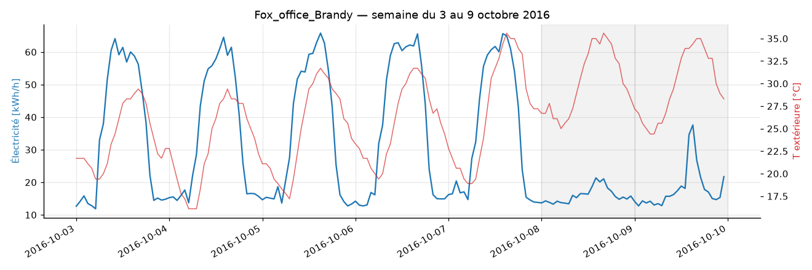
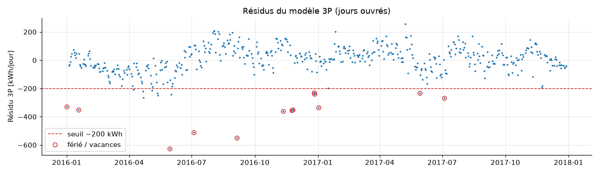

# Consommation de bâtiments : prévision et détection d'anomalies

Prédire la consommation électrique « normale » de bâtiments réels, repérer les dérives
(équipements qui tournent la nuit, chauffage/clim déréglés) et chiffrer les économies
après une rénovation (M&V, IPMVP / ASHRAE Guideline 14).

Données : [Building Data Genome Project 2](https://github.com/buds-lab/building-data-genome-project-2)
— ~1 600 bâtiments, compteurs horaires 2016–2017.

## Avancement

| Semaine | Objectif | Statut |
|---|---|---|
| 1 | Exploration d'un bureau : cycles et signature énergétique | ✅ |
| 2 | Baselines : profil moyen heure × jour, régression sur T | ☐ |
| 3 | LightGBM + validation temporelle | ☐ |
| 4 | Détection d'anomalies (résidus, seuils, anomalies injectées) | ☐ |
| 5 | M&V : économies en kWh et CHF après rénovation simulée | ☐ |
| 6 | Multi-bâtiments, README final | ☐ |

## Premiers résultats (bureau `Fox_office_Brandy`, Arizona)



**Signature énergétique** : modèle change-point 3P (refroidissement, ASHRAE Guideline 14)
sur les jours ouvrés : T équilibre ≈ 21,8 °C, talon ≈ 645 kWh/j, pente ≈ 47 kWh/j/K.

| Jours ouvrés | R² | CV(RMSE) |
|---|---|---|
| tous | 0,87 | 11,6 % |
| hors jours fériés / vacances | 0,91 | 9,2 % |


Points clés :
- **Jours fériés** : les plus gros écarts au modèle sont tous des jours fériés ou des
  vacances universitaires. Il faudra une feature calendrier pour ne pas les prendre
  pour des anomalies.
- **Pas de chauffage électrique** : un modèle 5P n'apporte rien (CV(RMSE) identique).
  Le chauffage est probablement assuré par le réseau de chaleur du campus.
- **Fuseau horaire** : le démarrage reste à 6 h toute l'année (l'Arizona n'a pas
  d'heure d'été), mais les métadonnées indiquent `US/Mountain` au lieu de
  `America/Phoenix`, ce qui décalerait les données d'1 h en été.
- **Saisonnalité résiduelle** : à température égale, la consommation est plus élevée
  en fin d'été (mousson → humidité), ce qui donne une piste pour le point de rosée.



Notebook complet : [PDF](reports/01_exploration.pdf).

## Reproduire

```bash
python -m venv .venv && source .venv/bin/activate
pip install -r requirements.txt
python -m src.download_data      # ~200 Mo dans data/raw/
jupyter lab notebooks/
```

## Structure

```
data/raw, data/processed   # données (non versionnées)
notebooks/                 # analyses numérotées
src/                       # code réutilisable
  data.py                  #   chargement bâtiment + météo
  changepoint.py           #   modèles 3P / 5P (ASHRAE G14)
  metrics.py               #   R², CV(RMSE), NMBE
reports/                   # PDF des notebooks et figures exportées
```

Code formaté avec [Ruff](https://docs.astral.sh/ruff/) (`ruff format . && ruff check .`).
