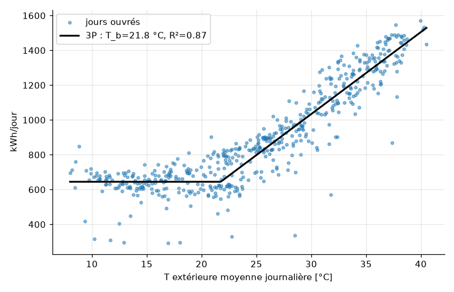

# Consommation de bâtiments : prévision et détection d'anomalies

Prédire la consommation électrique « normale » de bâtiments réels, repérer les dérives
(équipements qui tournent la nuit, chauffage/clim déréglés) et chiffrer les économies
après une rénovation (M&V, IPMVP / ASHRAE Guideline 14).

Données : [Building Data Genome Project 2](https://github.com/buds-lab/building-data-genome-project-2)
— ~1 600 bâtiments, compteurs horaires 2016–2017.

## Avancement

| Semaine | Objectif | Statut |
|---|---|---|
| 1 | Exploration d'un bureau : cycles et signature énergétique | ✅ |
| 2 | Baselines : profil moyen heure × jour, régression sur T | ☐ |
| 3 | LightGBM + validation temporelle | ☐ |
| 4 | Détection d'anomalies (résidus, seuils, anomalies injectées) | ☐ |
| 5 | M&V : économies en kWh et CHF après rénovation simulée | ☐ |
| 6 | Multi-bâtiments, README final | ☐ |

## Premiers résultats (bureau `Fox_office_Brandy`, Arizona)


Modèle change-point 3P (refroidissement) sur les jours ouvrés :
T équilibre ≈ 21,8 °C, talon ≈ 645 kWh/j, pente ≈ 47 kWh/j/K, R² = 0,87.



## Reproduire

```bash
python -m venv .venv && source .venv/bin/activate
pip install -r requirements.txt
python -m src.download_data      # ~200 Mo dans data/raw/
jupyter lab notebooks/
```

## Structure

```
data/raw, data/processed   # données (non versionnées)
notebooks/                 # analyses numérotées
src/                       # code réutilisable (chargement, modèles)
reports/figures/           # figures exportées
```
